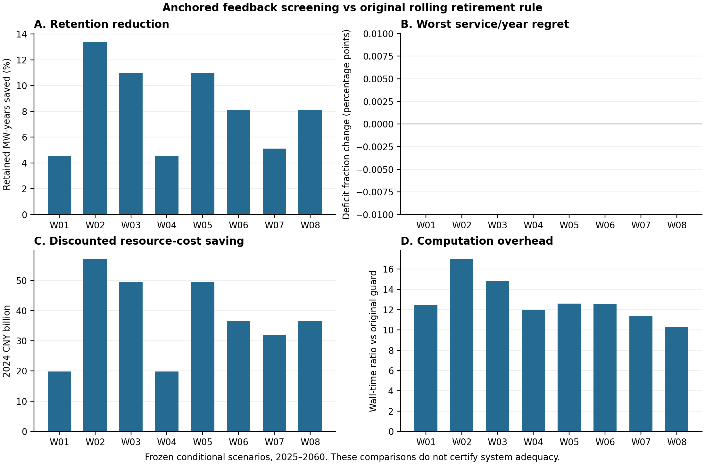

# PR14底座上的退役审查研究

本轮取得一个达到项目内部N2经验标准的方法增量候选：以原滚动规则为基准，用完整年度反馈逐项取消无服务收益的延退动作。最终8个条件均少延退，逐年逐服务缺供均未恶化；全国系统保供缺口仍在，不支持N3。人工评审未完成。最终判定见[验收收据](../../outputs/research_n2/final_acceptance.json)，五类研究记录及失败历史见[n2-research-ledger.md](n2-research-ledger.md)，先例范围见[n2-prior-art.md](n2-prior-art.md)。

## 方案结构

Q1继续负责公开来源、现实规模和风险暴露解释。Q2采用用户选定的lb PR14固定提交`1b8f465783afe7505c8d4e65ec43ada18c311daf`，保留其补贴到账、债务、有限销售竞争、付款建设和设备更新机制。Q3新增退役动作审查作为独立研究层；当前分支没有提前合并PR14，也没有用新结果覆盖旧Q3收据。

研究问题收缩为：在原规则决定延退时，哪些保留动作确实改善未来服务，哪些只增加费用或排放？这一局部问题不等于已经修复全国供需、历史容量误差或全国净零输入缺口。

## 当前候选的决策步骤

1. 当年完成运行、结算和普通主体申请，保留已经付款、批准或锁定的队列。审查下一年到期的初始煤电提前退出动作，最早请求年2028，最长延退3年且不超过原自然寿命。
2. 先按原rolling_guard、相同三年窗口和0.85风光压力判断。原规则准许退出时照常退出；原规则要求保留时才启动较贵的反事实审查。
3. 在当年可见状态上克隆两个分支。相同部门需求、共同气源、账户、债务、建设付款和后续普通主体决策都真实推进。分支仅持久化当时已见冲击与当年已观测GDP增长，不读取真实未来事件日历或未来GDP分段路径，也不在预测分支内递归启动研究规则。
4. 按容量从大到小尝试取消一项保留。必须在每一个服务与预测年份上，都不比当前可合法保留的参照更差，才接受取消。重复接受的动作仍需对完整参照逐项核验；不把不同服务缺供量相加。
5. 只执行当年的动作。保留费按2万元/MW年视为额外维护服务资源耗费，计入当年资源成本一次，同时记录公共支付/承包方收入等额双边账；年度上限为GDP的0.05%。这笔费用使用独立的外生公共专项额度，没有从PR14财政账户现金中扣除，也不挤占其建设补贴。已有运行成本、债务及建设费用照常结算。它是继承原Q3的条件性额外服务费用假设，不是官方补偿标准或已识别的实际财政空间；不能把等额双边记账称为完整财政现金闭环。

该过程是有限候选的顺序筛查，不求全局最优。三年逐服务不恶化是预测分支上的局部性质，不能推出未来实际路径、任意冲击或全国系统永远安全。参照自己越过2%研究服务界时仍记录越界，绝不改称已经满足安全约束。

## 正反证据如何分开

- R0：固定PR14原S0的完整参考复现及代码/输入哈希核验。
- R1：静态逐服务配对探索；保留工程延迟时多缺供25个百分点的反例。
- R2：改用年度主体闭环，三个已接触条件的探索。
- R3：未锚定版本的八个冻结条件检验；其中出现比原规则多保留容量年的反例。R3不会被修订版本的成功覆盖。
- R4：仅在原规则延退时精简的修订，复查已经接触的反例。
- R5：新的八条件冻结检验，门槛与R3数值相同。
- R6：固定共同初始项目的消融，禁止新增发电/基础设施，正常付费设备更新保留；与动态主体组分报。
- R7：在R5相同条件补全成本、容量、短视与静态配对对照，不增加验证样本数。
- R8：W08另进程不同哈希种子复现历史版本。
- R9：发现历史闭环版本仍可见未来GDP分段路径，改为当年增长持久化；按原条件、原门槛复算全部主验证、固定消融及W08复现。最终结论只用此版，信息收紧后复算不称新的盲测。

成本/容量规则、替代可用、静态配对、短视配对及未锚定闭环等对照均有明确实施。R5保留固定日程、替代可用、原滚动和未锚定闭环作为主要对照。冻结条件是内部研究协议；不是对外注册的试验，也不是新的独立历史观测。

## 最终结果与方法增量

验收门槛在R3登记、R5及R9沿用，未按结果放宽：8条件全部完成；至少6个少延退、至少4个节省≥5%、至少6个在强对照中不被支配；每条件最大服务缺供率增量≤0.001、资源成本增量≤0.01%、CO2增量≤0.2%；每批次退出日期不得推迟，期末受管理容量增量≤0.001MW；单候选路径≤360秒，资金与物理守恒检查通过。实际服务增量为0；协议容差与实际结果分别报告。该内部门槛未经外部专家认证，不是比赛官方N2定义。

下表均为2025—2060累计量，比较最终当前信息版与原`rolling_guard`。延退容量年是各次实际延退MW的逐年累加；节省率以原规则为分母。折现资源成本为PR14运行及建设资源成本加一次额外维护服务费；公共支付/承包收入是同一笔费用的对账，不再重复相加。若实际补偿只是纯转移支付而无额外资源耗费，必须另作敏感性检验，不能直接套用此处成本结果。

| 条件 | 延退容量年节省 | 折现资源成本节省（十亿元，2024年价） |
|---|---:|---:|
| W01 speed6 lag1 | 4.508617% | 19.869600 |
| W02 speed6 lag3 | 13.369111% | 57.069082 |
| W03 speed8 lag2 | 10.953015% | 49.568078 |
| W04 authority5 | 4.508617% | 19.869600 |
| W05 authority100 | 10.953015% | 49.568078 |
| W06 low_cash | 8.103810% | 36.448885 |
| W07 high_growth | 5.125626% | 32.059353 |
| W08 compound | 8.103810% | 36.448885 |

8/8少延退，6/8超过5%；所有逐服务/年份缺供率与原规则相同，最大增量为0。任何受管理批次均未比参考更晚退出，期末受管理容量不增加。在包含替代可用、成本/容量排序、静态配对、短视配对及未锚定闭环的完整强对照中8/8不被支配。这里的“不被支配”只表示没有一个对照在定义的全部指标上压过候选，不表示候选全面优于所有对照。

总折现资源成本仅下降0.0109%—0.0314%，额外公共保留费减少22.19—77.66亿元；CO2下降0—0.01708%，高增长条件无减排。每条完整路径约107—155秒，为原规则约10.3—17.0倍。这是减少无效保留的增量，不是运行速度创新。8/8仍违反2%研究服务硬界，不能将“风险不增加”表述为“安全达标”。



固定初始项目消融中，少延退11.79%、服务相同、资源成本下降0.0362%、CO2下降0.0124%，但严重缺供仍在。它只检查机制在单一固定项目条件下的表现。8个主条件按物理路径签名分为7类，不能视为8个独立随机样本；全部213条有效路径含历史探索、对照与重复运行，不作为统计样本量。未计算无独立性依据的显著性或置信区间。

方法增量来自两个共同必要的修订：完整年度反馈修复静态筛查在工程延迟下的服务反例，原规则基准限制修复未锚定闭环的过度保留和更晚退出。预测安全过滤、模型克隆和贪心删除本身均有先例；本轮只验证其在PR14付款、队列、主体与分项服务约束下的具体组合效果。N2是内部经验等级，专业原创性认定、全球首创和N3均未证实。

## 复现入口

使用现有`requirements-q2.txt`依赖和Python 3.12。先确保仓库包含固定PR14提交，再在A题目录执行：

```powershell
python -B -X utf8 scripts/prepare_n2_baseline.py
python -B -X utf8 scripts/run_n2_validation_batch.py --protocol workflow/n2_validation_r9.json --runner scripts/run_n2_current.py --workers 2 --output tmp/n2/reproduce_r9
python -B -X utf8 scripts/verify_n2_research.py tmp/n2/reproduce_r9
python -B -X utf8 scripts/check_n2_implementation.py
```

输出目录必须是新目录，防止旧成功文件覆盖本次失败。便携模式只核验已提取快照及原模型代码；原始PDF需另走PR14完整档案核验入口。单次年度路径与完整验证批次的耗时分开报告，不能把混合诊断计数器称为全部LP次数。

上述命令只重跑主验证及14项研究测试。完整补充验收还需要R7四个强对照、最终固定项目消融、不同哈希种子复现及339项既有测试。`verify_n2_supplements.py`默认读取`tmp/n2/r7`、`r9`、`r9_fixed`、`r9_reproduction`、`research_tests.json`及`legacy_tests.json`；不能只运行主批次就声称全部复现。

在全新复现目录按上述命令完成主验证后，可执行以下补充命令。`tmp/n2/r7`须不存在；若已有有效历史结果，应保留并核验，不覆盖。最后命令的`--primary`为`tmp/n2`下目录名。

```powershell
python -B -X utf8 scripts/run_n2_validation_batch.py --protocol workflow/n2_controls_r7.json --runner scripts/run_n2_research.py --workers 2 --output tmp/n2/r7
python -B -X utf8 scripts/run_n2_fixed.py --protocol workflow/n2_fixed_r9.json --output tmp/n2/reproduce_fixed
$env:PYTHONHASHSEED = '83'
python -B -X utf8 scripts/run_n2_current.py --protocol workflow/n2_reproduction_r9.json --output tmp/n2/reproduce_repeat
Remove-Item Env:PYTHONHASHSEED
python -B -X utf8 run.py test
Copy-Item outputs/validation/tests.json tmp/n2/legacy_tests.json
python -B -X utf8 scripts/verify_n2_supplements.py --primary reproduce_r9 --fixed reproduce_fixed --reproduction reproduce_repeat
```

先确认每一步返回0再继续。`run.py test`会更新原测试收据，已有工作区应先保存原字节，另存本次收据后恢复。最终W08复现与原运行全部科学JSON字段相同；耗时和环境记录不要求字节相同。353项测试由339项既有测试和14项研究测试构成。

完整证据保存在[outputs/research_n2](../../outputs/research_n2/README.md)：历史失败、协议、源码快照、主结果与消融/复现分目录。大JSON使用无损gzip，`archive_manifest.json`记录压缩和解压哈希；解压归档后重新验收属于证据核验，不等于重新执行仿真。

## 当前不能声称什么

不得把程序通过当作N2通过，不得把内部N2经验标准当作全球原创认证，也不得声称N3。预测安全过滤、MPC、反事实克隆和事件触发均有先例。本项目要证明的是它们针对真实付款、工程队列和服务分项耦合后，能否在本题的强对照中形成有效增量。

PR14的历史拟合与初态重建限制继续存在；代表日不提供全年连续灾害可靠性，聚合节点不代表全国跨省网络，未接入完整非能源排放与净移除不代表全国碳中和。所有本轮构思、代码、实验、查新和文档均有AI实质参与，最终使用前须由团队人工理解、复跑和签认。
