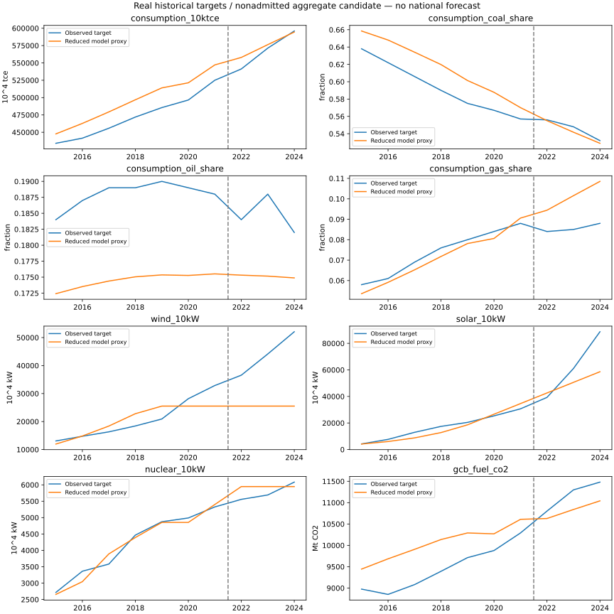

# 问题二交付检查与第十二轮联合校准

日期：2026-10-19。**当前仍为部分完成，不能按问题二完整成果验收。**

本轮针对油、气、风、光四项失败作联合修正。训练损失从 0.161514 降到 0.137754；油占比留出 MAPE 从 9.20% 降到 5.15%，但仍劣于持平基线。四项质量门槛依然未通过，六组全国输入未获准入，全国 S0 和全国三因素灵敏度仍未交付。以下新结果不替代这三项缺口。

## 本轮实际结果

| 指标 | v10 留出 MAPE | v12 留出 MAPE | v12 RMSE / 持平基线 | 原数值门槛 |
|---|---:|---:|---:|---|
| 一次能源消费代理总量 | 1.16% | 1.40% | 0.202 | 通过 |
| 煤占比 | 0.33% | 0.63% | 0.265 | 通过 |
| 油占比 | 9.20% | 5.15% | 2.365 | 未通过 |
| 气占比 | 19.45% | 18.40% | 5.671 | 未通过 |
| 风电装机 | 41.13% | 41.12% | 1.518 | 未通过 |
| 光伏装机 | 19.71% | 19.85% | 0.485 | 未通过 |
| 核电装机 | 4.58% | 4.58% | 0.558 | 通过 |
| 有效系数化石 CO₂ 代理 | 4.14% | 3.16% | 0.401 | 数值通过，物理边界未准入 |

完整逐年结果见 [history_fit.csv](../../outputs/q2/historical_candidate_v12/history_fit.csv)，逐项判定见 [historical_quality.json](../../outputs/q2/historical_candidate_v12/historical_quality.json)。图中仍标注模型为聚合代理。



## 直接诊断与检验

原 v10 的[施工使用记录](../../outputs/q2/historical_candidate_v10_comparison/constraint_usage.csv)显示，选中结构的年度施工及接入上限均为 150000 MW。2017 年起两者同时绑定；2019—2024 年风电获批量均为零，风电经营容量因而停在约 255.18 GW。行为账同时保留风电正投资净现值、申请和零批准。这证明了原模型内的约束挤出，不能解释为现实风电不愿投资。

原 v10 的[技术运行记录](../../outputs/q2/historical_candidate_v10_comparison/technology_activity.csv)显示，气电 2014—2024 年发电均为零。现有全国单区聚合运行没有重现气电实际用途，残余燃气需求与气电映射不完整。新增部门能量输入分类也不能自动提供热、交通等有效服务或设备替代关系。

因此，本轮同时检查需求响应和部署约束，避免继续固定粗网格燃料参数后单独调风光。设计在运行前写入[冻结协议](../../workflow/q2_candidates/v12_joint_response.json)：

- 保留 v10 训练选中的初始光伏队列；油、气残余需求 GDP 弹性与风、光存量扩张率四参数联合优化，沿用原参数范围。
- 比较固定 150 GW、随当期累计 GDP 指数一次方/二次方变化的共同额度，以及原有分技术额度。GDP 指数额度是研究假设，不是实测施工/电网能力；未来 GDP 不倒灌过去。
- 每个结构比较原有即时与自适应预期；另保留原 v10 完整模型和无投资控制。未更改八项指标、权重、尺度、窗口和验收阈值。
- 在归一化的四参数空间使用有界最小二乘，每组一个固定起点、最多 40 次主函数评估；有限差分造成的实际训练执行全部计入日志。不是全局最优证明。

共执行 250 次训练，其中原控制两次，其余 248 次包括优化器差分评估。全部成功，累计训练执行 5995 次，包含重复控制，不代表独立观测数量。八组优化器均返回正常终止；[原始执行日志](../../outputs/q2/historical_candidate_v12/training_trials.jsonl)与[优化状态](../../outputs/q2/historical_candidate_v12/optimizer_status.json)保留。

训练仍选中固定 150 GW / 即时预期：风扩张率 0.239644、光扩张率 0.457490、油弹性 0.602234、气弹性 1.999983。气弹性仍贴近上界。GDP 比例、GDP 平方及技术额度的即时预期最佳训练损失分别约为 0.163047、0.162836、0.162836，均高于选中模型 0.137754。[选择记录](../../outputs/q2/historical_candidate_v12/training_selection.json)在留出运行前落盘；没有按留出表现改选结构。

这轮只支持“原粗网格和分步校准造成部分拟合损失”，不支持“四项误差已解决”。解除共同额度本身不能保证原加权目标选择新模型。继续扩大同类搜索不能补出未映射的服务、政策、运行条件和 2024 状态。

## 全国验收缺口及解除条件

| 缺口 | 仍然缺少的交付 | 解除时必须提供的证据 |
|---|---|---|
| 历史初态 | 部门有效服务、设备/替代、队列及资金的完整映射 | 2014 状态→2015 运行的能源和现金核对，燃烧/原料/转换余项可追踪 |
| 当前初态 | 同边界 2024 资产、燃料、服务、库存和在建队列 | 2024 观测及逐项研究假设、未知与冲突登记；不能把失败历史模型末态当观测 |
| 技术和价格 | 模型设备对应的效率、成本、寿命及政策覆盖 | 单位、价年、技术样本、合同/预算与参数实际绑定；目录存在不等于已使用 |
| 连续运行 | 负荷、风光水、燃料供给和库存条件 | 同期序列或明确的代表年假设及稳健性；年度进口不能直接当小时能力 |
| 碳边界 | 全国能源/非能源正排放、净移除及未来假设 | 同口径完整碳账；不将有效代理系数或未知原料排放当真实燃烧排放 |
| 全国实验 | 可执行的 S0 和 GDP/成本/碳价范围 | 2024—2060 输入绑定，2030/2060 全指标、实际三因素运行及复现记录 |

正式准入仍由 [q2_inputs.json](../../workflow/q2_inputs.json) 控制。不能删除缺口列表、改低阈值或将工程夹具改名为 S0 来制造成功。本轮没有全国新结果，也没有将 v10 的 27 组历史响应复用为 v12 或全国灵敏度。

## 复现与审查入口

仓库根目录安装 `requirements-q2-lock.txt` 后运行；输出目录必须尚不存在：

```powershell
python -B -X utf8 scripts/run_q2_joint_response.py --output-dir outputs/q2/replay_v12
python -B -X utf8 run.py test
python -B -X utf8 run.py q2 --config workflow/q2_inputs.json --output-dir outputs/q2/recheck_national
```

第一条应复现本轮历史诊断；最后一条当前应非零退出并列出六组缺口，不能视为全国交付成功。[完整模拟账](../../outputs/q2/historical_candidate_v12/result.json)、[选中模型](../../outputs/q2/historical_candidate_v12/selected_model.json)、[运行清单](../../outputs/q2/historical_candidate_v12/run_manifest.json)可逐项审查。隔离副本两环境复现结果记录于 [iteration12_reproduction.json](../../outputs/q2/iteration12_reproduction.json)。

147 文件隔离副本在锁定依赖环境重跑全部训练，16/16 个结果文件字节一致。另一构建环境也实际跑完，结构、规则、选中试验及八项通过/失败结论一致，但只有 1/16 个文件字节一致：连续优化出现浮点尾差，绘图还存在渲染差异。88 个年度指标最大归一化差异为约 5.40×10⁻¹³（分母为 max(1, 原值)）。第一次跨环境严格字节比较失败已[保留](../../outputs/q2/iteration12_reproduction.first-attempt.json)，不改称全部字节一致。

新增四项回归检查覆盖原目标函数一致性、留出目标和未来 GDP 污染隔离、零增长额度下物理/财务全路径一致性、输入不变与政策可见日期。396 项完整测试通过，14 项工作区审计通过；[正式入口实测](../../outputs/q2/joint_response_national_gate.failed-attempt.json)仍以非零状态拒绝六组缺口。完整状态见 [development_checks.json](../../outputs/q2/development_checks.json)；工程检查不替代全国科学验收。
