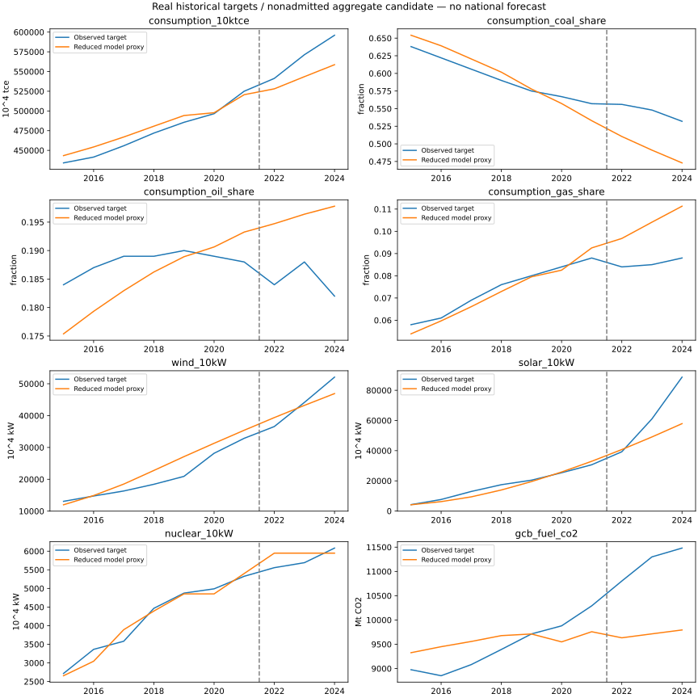

# v13：审批分配与需求联合校准

本轮训练选择了按可执行申请比例分配共用建设额度的方案，风电留出 MAPE 从 v12 的 41.12% 降至 6.57%，通过原质量门槛。但煤占比和 CO₂ 代理指标退步，整体共有五项失败，仍不能用于全国 S0。单项改善不代表本轮已满足问题二。

## 预先固定的目标与实验

目标是检验审批顺序是否导致某种技术在持续正收益下长期拿不到建设额度，并检查先前固定的需求参数对多指标拟合的影响。训练窗口仍为 2015—2021，2022—2024 明确为已接触留出。八个目标、权重、尺度及原验收阈值不变。

新增的可选审批规则先剔除当期不具备许可的申请，应用技术组剩余额度和主体资金约束，再按同一比例缩放申请，使总建设量与接入量均不超过原限制。它只适用于单位 MW 的新增发电项目，不直接配置设备替代。未分配额度不在缩放后再次分配；资金检查不预支补贴。原收益优先规则仍是默认控制，完整 v12 物理、资产、项目、现金及行动账本已实际重跑并逐项相同。

比较三个建设上限设定（固定 150 GW、GDP 比例、技术组上限之和）、两种分配规则及两种预期规则，共 12 组联合拟合，并保留原 v12 和不投资控制。连续参数为原四个风光扩张率/油气响应参数，加上电力 GDP 弹性与煤残余需求的年度统计强度改善。电力弹性复用原 0.7—1.3 范围；煤强度 0—3%/年是本轮明示研究假设，由训练期煤、总能耗及 CO₂ 持续高估问题提出，不是观测设备效率。其他燃料强度、原始数据、期初队列和碳系数未改。

优化采用归一化参数和固定绝对步长的有限差分，避免接近零边界时相对步长过小。每组只有一个预设起点，不能据此声称全局最优。实际主实验执行 653 次训练，包括控制和有限差分；主实验累计 6648 次。两个独立环境的复现重复另列，不计入该主实验累计数。

选择在读取新候选留出结果前写入。最小训练损失从 0.1377543447 降至 0.0762185817，选中固定 150 GW、比例分配、即时收益规则。训练损失在最优值加 0.001 范围内仅此一组候选；没有将不同候选的有利指标拼接成一个结果。

| 拟合参数 | 训练选择值 |
|---|---:|
| 风电存量扩张率 | 0.2418344431 |
| 光伏存量扩张率 | 0.5082671370 |
| 油残余需求 GDP 弹性 | 0.7105777109 |
| 气残余需求 GDP 弹性 | 1.9343189348 |
| 煤残余需求年度统计强度改善 | 0.0300000000 |
| 电力 GDP 弹性 | 0.7168458276 |

煤强度参数达到研究上界，不能将它解释为已识别的真实节能速度。

## 留出结果与失败证据

门槛仍为各项 MAPE 不超过 15%、占比绝对误差不超过 0.05、RMSE 不劣于末个训练年持平基线，并要求全部目标族齐备。下表均来自同一个训练选中模型。

| 指标 | 留出 MAPE | RMSE/持平基线 | 结果 |
|---|---:|---:|---|
| 总能耗 | 4.53% | 0.5611 | 通过数值门槛 |
| 煤占比 | 9.89% | 3.5256 | 失败；最大占比误差 0.05899，且差于基线 |
| 油占比 | 6.32% | 2.8908 | 失败；差于基线 |
| 气占比 | 21.40% | 6.5490 | 失败；MAPE 与基线两项 |
| 风电装机 | 6.57% | 0.2638 | 通过数值门槛 |
| 太阳能装机代理 | 19.36% | 0.5007 | 失败；MAPE |
| 核电装机 | 4.58% | 0.5575 | 通过数值门槛 |
| 有效系数燃料 CO₂ 代理 | 13.18% | 1.5797 | 失败；差于基线，物理碳边界也仍未准入 |

2019—2024 年风电每年均获得正的建设分配，原来连续零审批的问题消失。2024 年风电申请获批约 35.62 GW，光伏约 92.42 GW，仍共同受 150 GW 上限限制；当年批准容量进入未来项目队列，不计为当年投运。比例分配没有消除共用建设上限对未来光伏扩张的限制，也没有解决气电零调度、油气用途及全国碳核算映射。



不能因为风电通过而忽略新增的煤与 CO₂ 失败，也不能根据留出结果退回另一个参数组宣称本轮通过。v12 与 v13 失败证据均保留。

## 验证与复现

423 项全量测试通过。新增规则覆盖技术组/建设/接入/资金同时限幅、许可过滤、申请顺序不变性、重复申请拒绝、默认规则保留及未来数据隔离。实际 v13 的 11 个年度、54 条分配申请另行核对：项目无当年投运，现金总量及队列托管相符，最大载体平衡残差约 1.86×10⁻⁹ MWh，现金和托管残差分别不超过 9.54×10⁻⁷、8.74×10⁻¹¹。原工程入口已重跑，19 个科学产物逐字节不变。

154 文件独立快照完成整个校准复跑。固定环境 18/18 产物逐字节相同。另一环境 3/18 逐字节相同，选择的结构、规则和八项验收判断一致；参数、指标和完整账本的最大缩放差分别约 1.21×10⁻¹²、9.74×10⁻¹³、9.54×10⁻⁷，满足复跑前固定的数值容差。优化轨迹和渲染差异逐项记录，不称跨环境逐字节一致。缩放定义为 `abs(a-b)/max(1,abs(a),abs(b))`，数值容差不改变科学验收门槛。

六组全国输入缺口继续保留；v13 未做全国 S0、全国灵敏度或完整问题二验收。旧 v10 历史响应不能当作 v13 灵敏度。

## 可审查入口

```powershell
python -B -X utf8 scripts/run_q2_allocation_candidate.py --config workflow/q2_candidates/v13_allocation.json --output-dir outputs/q2/v13_reproduce
python -B -X utf8 scripts/check_q2_allocation.py
```

第一个命令要求使用新输出目录。第二个命令核对本次保留的 v13 结果及已执行工程回归。

[冻结协议](../../workflow/q2_candidates/v13_allocation.json)、[训练选择](../../outputs/q2/historical_candidate_v13/training_selection.json)、[质量结果](../../outputs/q2/historical_candidate_v13/historical_quality.json)、[模型](../../outputs/q2/historical_candidate_v13/selected_model.json)、[完整账本](../../outputs/q2/historical_candidate_v13/result.json)、[年度约束](../../outputs/q2/allocation_year_checks.csv)、[申请核对](../../outputs/q2/allocation_request_checks.csv)、[守恒与回归](../../outputs/q2/allocation_checks.json)、[复现协议](../../workflow/q2_candidates/v13_reproduction.json)、[独立复现](../../outputs/q2/iteration13_reproduction.json)。
