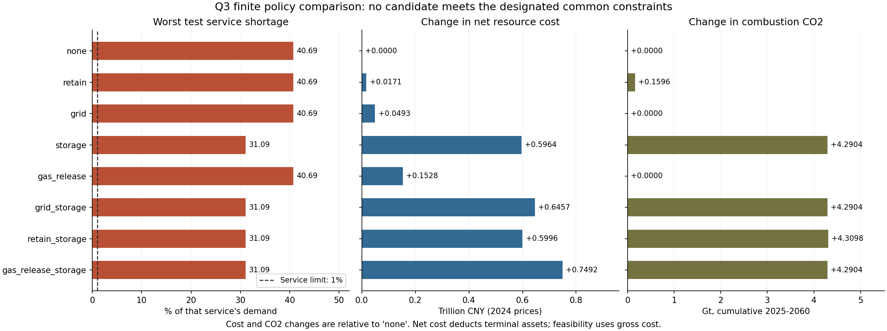

# P3/mmj：问题三条件情景、转型配套与政策筛选

2026-10-20。Issue #12，共同 base `500436ffe8a9ecdf0ebcad3cdae87ef9deddbf93`，分支 `p3/mmj`。沿用已合并的 lb PR #9，不引入PR #10/#11。全程未使用子智能体。

**V5完整条件实验、两轮作者自查及独立目录复现已完成。** 主运行 `20261020T013122048456Z`、独立运行 `20261020T013122175975Z` 均退出0，分别耗时1669.94秒、1658.42秒。V5主实验自查时339项测试全部通过、0跳过；C1—C8的作者证据见下表，C9仍需另外两人批准最终SHA。本轮尚未commit、push或创建PR；不把无可行政策、测试通过或作者复现替代团队验收。

其后已完成[零进口、服务分配与储能增排专项诊断](p3-mmj-diagnostics.md)：4对进口关闭控制、38次事件探针和71次年度储能控制完成，两轮核验与独立目录的16份产物比较通过，1项SOC不兼容控制明确保留。固定其余条件只替换储能能力，36年累计排放减少0.525251 Gt；原政策增排4.290365 Gt伴随不同资产和运行路径，不能归因于电池自身必然增排。主模型、原结果与门槛均未改，新增诊断的最新测试和审计见[专项验证汇总](../../outputs/validation/p3_mmj/diagnostics_validation_summary.json)，不覆盖下表的V5历史收据。

## 本次实际结果

完整产物见 [V5运行报告](../../outputs/q3/p3_mmj_v5/report.md)、[转型及五方面政策报告](../../outputs/q3/p3_mmj_v5/transition_report.md)和[实验完成收据](../../outputs/q3/p3_mmj_v5/transition_completion.json)。116个年度转型案例均完成，无意外求解错误、无固定项目融资失败。另有S0/SP/ST三条2025—2060年度路径及16组同状态H02事件；转型和政策模块另核验1376组连续事件、11008条逐服务指标。

| 研究项 | 当前结果及边界 |
|---|---|
| 六情景 | 2030的S0/SP/ST燃烧CO₂均为8.5833 Gt；2060的S0/SP为7.0048 Gt、ST为6.9942 Gt，见`scenario_comparison.csv`。这是继承聚合模型下的条件值，不能解释为官方预测或SP在所有年份均无作用。SG/SW/SGW是独立连续事件，未虚构年度灾害频率。 |
| H01 | 两类网格共60例，共同选择约束可行0/60，较深检验服务界内0/60。两个提前规则阈值均不可共同采用，`selected_epsilon=null`。固定项目对照中的30例均保持同一资本项目集合；完整主体响应下局部改善不等于时序本身已被证明有效。 |
| H02 | 两事件×八服务的16条交互记录中，`J`及`J正常−J冻结`均为0。16组配对事件的实际天然气进口量均为0，指定来源进口上限在这些解中未成为限制；不能据此推出气源风险不存在或否定其他条件下的耦合。 |
| 主政策 | 八候选均不满足共同约束，`selected_policy=null`。共同服务界为1%；部分储能候选改善缺供，但仍超界且增加累计燃烧排放。 |
| 敏感性 | 保留费用、公共预算、注采成本的半倍/双倍六个变体各跑八政策，48例全部完成，六组仍无可行候选。空选择一致不等于已证明某个政策具有稳健最优排名。 |

以`none`与`storage`比较，较深检验最坏服务缺供比例为40.6915%和31.0909%，对应2060年SW/SGW的交通服务代理量；减少9.6006个百分点，但仍超过1%。净资源成本增加0.596383万亿元（2024价、已扣期末资产），2025—2060累计燃烧CO₂增加4.290365 Gt。数据见 [policy_results.csv](../../outputs/q3/p3_mmj_v5/policy_results.csv) 和 [transition_event_metrics.csv](../../outputs/q3/p3_mmj_v5/transition_event_metrics.csv)，不能把单项改善表述为可实施政策已经通过。

原冻结散点图存在相近候选标签重叠。为保留运行收据，另由 `scripts/plot_q3_review.py` 从同一CSV生成下面的审阅图，[绘图收据](../../outputs/validation/p3_mmj/figures/plot_receipt.json)绑定源运行、CSV、脚本和图片。没有修改原数值、原图或原运行指纹。



原运行中的`report.md`、`gaps_and_conflicts.csv`和manifest记录的是当次计算结束时尚待独立复现的状态快照，故原字节保留。其后独立复现的完成证据为[第二轮自查](../../outputs/validation/p3_mmj/complete_review_round2.json)；当前状态以本文与[v5_validation_summary.json](../../outputs/validation/p3_mmj/v5_validation_summary.json)联合判断。

## 实现与冻结方案

| 工作包 | 实际机制 |
|---|---|
| 六情景 | S0/SP/ST从2024初态运行至2060；S0/SG/SW/SGW复制同一2030状态做连续条件事件。单项变化与叠加分别登记。 |
| H01 | `vR×L`、`vE×L`合计6个不同点；固定日程、费用排序、服务可用后退出、提前规则两个阈值；固定项目与完整响应分报，共60个年度案例。 |
| H02 | 逐服务四组J及电池放电动作冻结；保留资源/初态/服务，不以非加性单独证明传播。 |
| 政策 | 无额外政策、资产保留、电网、储能、气体注采及三项必要两两组合，共8个；实际审批、付款、工期和维护。 |
| 敏感性 | 保留费用、公共预算、注采成本分别半倍/双倍，各跑8个候选，共48个年度案例。 |
| 过程证据 | 年度运行输入与输出、资金/托管/建设/设备账、逐服务连续缺供与恢复；案例压缩JSON、汇总CSV、五方面建议与图表。 |

主要代码为 `src/energy_model/q3_transition.py`、`q3_events.py`、`scripts/q3_campaign.py` 和 `q3_reporting.py`。Q2只新增两个默认行为不变的审批扩展接口；新增LP边界约束默认不启用。沿用原历史参数，不按冲击重新拟合。

完整配置：[q3_inputs_v5.json](../../workflow/q3_inputs_v5.json)。新用途：[事件审查](../../data/catalog/q3_input_review.json)、[转型政策审查](../../data/catalog/q3_transition_review.json)。V2—V4配置和失败记录原样保留。这些是作者冻结的条件设定，不是假定已获三人批准的现实政策。

- `vR={0.01,0.03}`为相对初始煤电规模的年提前退出授权上限，只涉及重建初始机组及原技术寿命前5年。`vE={0,0.6}`为继承成本判据下到期更新/扩建设备的采用份额；没有瞬间替换在用设备。`L={0,3}`仅增加网、储、注采工期。
- 提前规则先用当前资产、已承诺且有资金的队列、当前增长预期和冻结压力条件预测3年，再审批当年退出。阈值为0.005/0.01；不读取未来实现状态或尚未公开的固定申请。
- 资产保留每年支付账面建设费用的1%，最迟到原技术到期或2060；没有新增真实延寿许可。聚合煤电同质时费用排序可与固定日程重合，不编造逐厂成本差异。
- 额外公共拨款每年上限为2024价GDP的0.0005；审批即占全部资本额度、托管资金按工期支付。保留和维护共用上限。各候选实际花费允许不同，不称等实际支出。
- 气体注采成本、2年工期、20年寿命是条件工程假设；仅提高已有库存的出入速率，不赠送燃料/库容/来源。新增储能继承技术效率与寿命，不能免费选择技术突破。
- 末期价值包括存续资产，以及已付款在建电源、网储、注采和终端设备。未支付托管金不重复充当资源资产；毛/净成本、残值和转移分账，残值是账面约定而非市场售价。
- 主政策界：累计燃烧CO₂不高于同参数无额外政策对照、折现毛资源成本不高于1.05倍、每项服务缺供比例不超过1%。H01阈值也须满足共同界；无可行阈值就输出空选择。其他界只作敏感性。

EI原工作簿45个单元格、表头及合计已实际核验。约0.215856的指定来源份额只拆分已有条件进口包络；将2024组成保持到2030/2060是假设，未把年度bcm当作实测小时交付能力。连续事件为6小时时段，不乘年度权重；前段共用，不允许预知冲击改变事前库存。原料用煤、油、气分别报告。

恢复判定需连续4个时段满足服务。`recovery_status`区分零需求、未发生中断、已恢复、未恢复/确认窗口不足；后者的恢复时间为空。`right_censored`仅标记窗口终点仍在缺供，不能单独用其false推断已恢复，须同时读取恢复状态。

`selection_lock.json`写出后才执行较深检验；开发已接触该条件，不能称盲测。完全相同的事件输入可在同次运行按完整哈希复用确定性结果，命中数单列，不使用旧版本数值。固定项目无法支付同一申请时判失败，不能暗改项目后宣称时序比较。

## 自查与诚实失败

首阶段记录见 [p3-mmj.md](p3-mmj.md)，其中321项测试和13份CSV复现只是当时快照，不能代替当前V5收据。第一轮方法检查见 [method_review_round1.json](../../outputs/validation/p3_mmj/method_review_round1.json)。

1. V3完成73个年度案例后停止：预测触发投资，但未完整参与当前退出审批。修复为预测在先、审批在后，加入“当前无缺供、未来缺供”反例。
2. 阈值排名曾未单独拒绝共同约束不满足的候选。现区分可行性与排名；无可行值不选最不差值冒充通过。
3. 补齐各年运行约束，支撑设备能力、付款预算、电网交付等同时约束诊断；不把诊断标记当作唯一原因证明。
4. V4主目录与独立目录各完成20例后停止：已付款、2061投运的终端设备漏入2060在建资产。V5补齐，新增反例，独立审查从队列重算。

各停止版本的manifest和最新尝试均明确失效，旧数据/代码快照与原因保留。修复没有调整情景、网格、预算或误差界。Windows临时目录权限导致的早期测试错误也保留，之后使用当前用户权限真实重跑，没有改成跳过。

最终[第一轮账本自查](../../outputs/validation/p3_mmj/complete_review_round1.json)通过10组检查；[第二轮自查](../../outputs/validation/p3_mmj/complete_review_round2.json)通过13组检查。`scripts/review_q3_complete.py`从导出数据独立重算能碳、资金、项目、期末价值、每个H01点和六组敏感性的可行性，并逐行将汇总结果追溯到原始账本。第二轮比较独立checkout、`PYTHONHASHSEED=1729`的完整入口：26份科学CSV、116份年度案例、232份事件文件、6份项目计划、6份敏感性锁和主选择锁全部逐字节一致。独立复现仍由作者执行，不能替代另外两人的C9评审。

## 环境与回归

使用 `.venv/Scripts/python.exe`（Python 3.12.14）；系统默认3.10不合要求。NumPy 2.3.5、SciPy 1.16.3、Mesa 3.3.1、pandas 3.0.1、Matplotlib 3.10.7、ReportLab 4.5.1已核对，HiGHS实际求解及pip依赖检查通过。本轮没有新依赖。

本轮没有随机抽样；Mesa实际继承Q2设计的初始化种子204804。配置中历史保留的 `random_seed=12` 未传入模型，不能当作随机鲁棒性证据，核对见 `outputs/validation/p3_mmj/runtime_seed_review.json`。独立复现改变的是Python哈希种子，仍需比较实际结果。案例JSON的原Q2路径字段保留回放身份，Q3安全判断只使用分别报告的服务指标，不使用原跨服务汇总字段。

Q1重跑到独立输出；Q2在原参数下重放2015—2024历史路径、原规则对照和未来S0。**未重跑1012次校准搜索**，不刷新旧Q2收据冒充新搜索；回放明确区分逐字节相同与原容差内一致。Q2既有残差、统计桥接、聚合初态及缺少CO₂留出等限制继续由Issue #7跟踪。

## 完整入口

```powershell
.\.venv\Scripts\python.exe -B -X utf8 run.py q3 --config workflow/q3_inputs_v5.json --output-dir outputs/q3/p3_mmj_v5
.\.venv\Scripts\python.exe -B -X utf8 run.py test
.\.venv\Scripts\python.exe -B -X utf8 run.py audit
.\.venv\Scripts\python.exe -B -X utf8 scripts/scan_google_keys.py
.\.venv\Scripts\python.exe -B -X utf8 scripts/workflow_status.py --check-formal-inputs
.\.venv\Scripts\python.exe -B -X utf8 scripts/review_q3_complete.py --output-dir outputs/q3/p3_mmj_v5
.\.venv\Scripts\python.exe -B -X utf8 scripts/plot_q3_review.py
```

每次运行保留尝试、模型/输入快照、环境和递归产物指纹；使用结果前检查`verify_latest()`。退出码0只表示请求的条件计算完成。无可行政策是有效研究结果，求解/准入错误或旧成功失效则不得伪装成功。

| 验收 | 当前作者检查状态与证据 |
|---|---|
| C1 | 通过：固定base；11份原件/契约与base逐字节一致；两份Q3用途审查、V3—V5协议及停止版本来源记录齐全。 |
| C2 | 通过：六情景真实运行、长期/事件分开、同状态前段反例与S0回归；`scenario_comparison.csv`、`q2_baseline_replay.json`。 |
| C3 | 通过：116份年度账、1376组连续事件的能碳/库存/服务复算；公共预算、资金、建设与末期资产核验见两轮自查。 |
| C4 | 通过条件实验要求：60例、两个网格、四类规则、两种响应模式、前瞻审批及全部失败约束公开；不宣称存在可用阈值。 |
| C5 | 通过条件实验要求：16条逐服务J、合法电池冻结、连续过程与恢复核验；零交互的适用边界如上。 |
| C6 | 通过条件实验要求：八政策、48敏感性案例、主约束与取舍表、检验及五方面建议；结果为无可行候选。 |
| C7 | 通过：42项Q3专项测试含缺输入/坏指纹/用途撤回/不可行/不恢复/旧成功失效等反例；V3/V4停止证据保留，不将失败填零。 |
| C8 | 通过作者检查：[339项测试](../../outputs/validation/p3_mmj/full_tests_v5.json)、原件审计、密钥扫描、九子集、Q1重跑、Q2原参数回放与完整独立目录复现；未重做1012次历史搜索。当前汇总见[v5_validation_summary.json](../../outputs/validation/p3_mmj/v5_validation_summary.json)。 |
| C9 | **未完成：待另外两人批准同一最终SHA**。作者复现和本地未提交修改不能替代正式交叉评审。 |

模型仍为全国聚合条件研究；无跨省网络、真实灾害概率、完整氢/CCUS初态，不输出官方预测、全国可靠性认证或全温室气体中和结论。论文、视频和展示界面不在本轮制作范围。
