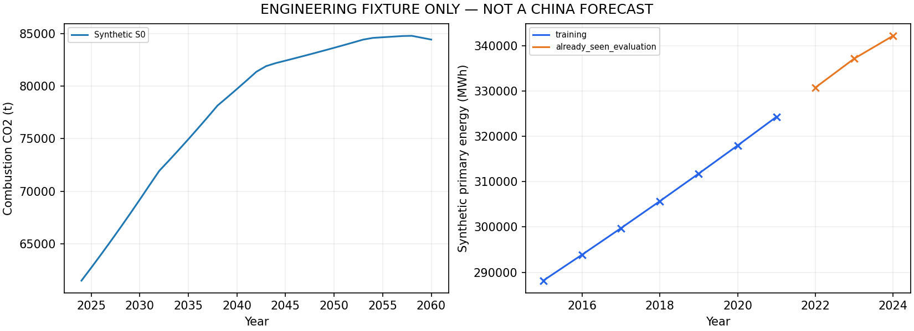

# Q2 工程闭环验算（全部合成，非中国预测）

本次执行了 Mesa 年度主体、SciPy 跨时段 LP、27 组多目标参数搜索、已接触留出、持平基线、关闭投资/替代的规则对照、独立2024初态至2060以及三因素灵敏度。

校准观测由同一模型生成，只证明程序与约束可运行，不证明真实历史解释力；不能将拟合优度写入全国模型验证结论。

最佳训练损失：0；等效参数组：3；灵敏度失败记录：0。

正式全国入口保持非零阻断。研究假设、全国数据审查和团队验收尚未完成。

