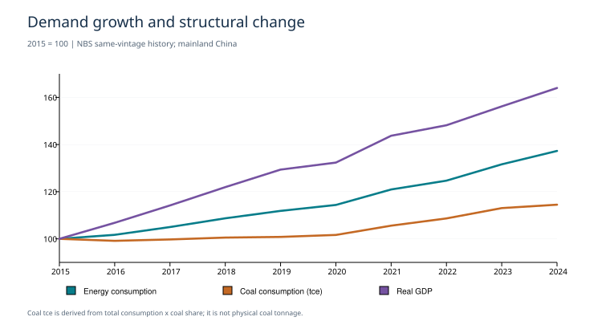
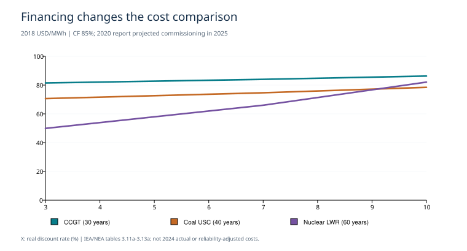
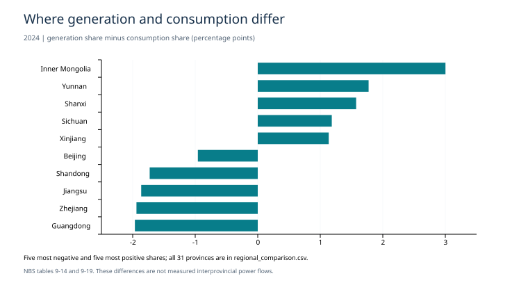
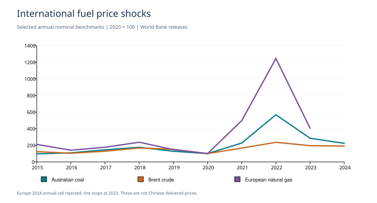

# 问题一：我国多能源发展现状评估（p1/lb）

研究日期：2026-10-18。共同起点：`7a65d068d19eea2f7dd8161a618a3ad8d66f98b8`。本报告已完成问题一三个子问题的本地研究交付，细项缺口及逐项判断见[最终核对](../../../docs/solutions/p1-lb-final-acceptance.md)。未完成三人评审或合并，不代表所有数据字段无缺失。

## 1. 主要判断

2015—2024年能源消费由43.4113增至59.60亿吨标准煤（增长37.29%）。煤炭份额由63.8%降至53.2%，但同表推导的煤炭标准煤消费量由27.6964增至31.7072亿吨。结构转型与绝对需求增长并存，不能只凭份额下降判断煤炭需求已见顶。

2023年同表净进口/消费：石油78.85%、煤炭9.99%。石油包括油品等原表边界，不能改称原油依存度。天然气进口中LNG占58.17%；全年分项用途说明工业与气电应共用气源约束，但不足以计算中断损失。

2024年31省发电份额与用电份额差异指标为0.1266。它衡量空间分布不同，不能直接变成实际跨省输电量或安全等级。成本对比则表明，折现率和利用率变化能改变煤、气、核电的排序，因此后续模型应保留资金与运行条件。

## 2. 边界、来源与历史覆盖

地理主线为中国大陆。统计局2025版同版历史为主，2015—2024为比较窗口；2005起部分序列作背景。2023细账、2024现状、2025更新和2020报告对2025的成本投影分别标记。研究数据库的China编制口径保留，未经桥接不混为同一套观测。

[history.csv](history.csv)含2146条已选来源记录；[coverage.csv](coverage.csv)逐系列列明缺年。[indicators.csv](indicators.csv)含182条指标记录、110个指标标识，含不同年份、参数变体及上下界，不代表独立指标数量。独立公报和研究汇编作为单独版本，不能因文件不同重复算独立样本。所有关键结果可由input_refs回到history中的原件定位，再由[输入锁定清单](../../../workflow/q1_inputs.json)回到原件哈希。

## 3. 规模、结构与低碳

|指标|2015|2024|口径|
|---|---:|---:|---|
|消费/亿吨标准煤|43.411|59.600|同序列指数；具体公式见指标表|
|煤炭份额/%|63.800|53.200|同序列指数；具体公式见指标表|
|能耗强度/2015=100|100.000|83.717|同序列指数；具体公式见指标表|
|化石工业CO₂强度/2015=100|100.000|76.015|同序列指数；具体公式见指标表|

强度分母为同版实际GDP增速连乘指数。全口径能耗强度不同于官方扣除原料及非化石用能的指标。GCB为属地化石和工业CO₂，包含过程排放且不含土地利用及净移除，不能代表全国净温室气体或证明碳中和。

|年末装机/万kW|2015|2024|
|---|---:|---:|
|总装机|152,527|334,922|
|火电|100,554|144,462|
|水电|31,954|43,552|
|核电|2,717|6,083|
|风电|13,075|52,078|
|太阳能|4,218|88,742|

|生产/发电规模|2015|2024|单位|
|---|---:|---:|---|
|一次能源生产|36.219|49.800|亿吨标准煤|
|原煤产品产量|37.470|47.810|亿吨|
|天然气产量|1346.100|2464.510|亿立方米|
|总发电量|5814.573|10086.881|TWh|

一次电力及其他能源一栏保留原名，不直接改成非化石；天然气不算非化石。装机、发电和一次能源消费三种份额分别报告。火电还包含生物质、垃圾和余热等，不能全部当化石发电。

|补充技术证据|2015|2024|单位/边界|
|---|---:|---:|---|
|煤电|4046.17|5827.60|TWh，OWID上游研究汇编，单独口径|
|气电|166.91|320.72|TWh，OWID上游研究汇编，单独口径|
|油电|36.46|88.88|TWh，OWID上游研究汇编，单独口径|
|水电|1114.52|1354.25|TWh，OWID上游研究汇编，单独口径|
|核电|171.38|450.85|TWh，OWID上游研究汇编，单独口径|
|风电|185.59|997.04|TWh，OWID上游研究汇编，单独口径|
|太阳能发电|39.48|839.04|TWh，OWID上游研究汇编，单独口径|
|生物质发电|54.07|208.50|TWh，OWID上游研究汇编，单独口径|

2024年氢气总产量公布为超过3650万吨；煤制、天然气制、副产、电解的公布近似分项合计3632万吨，比总量下限少18万吨，不能将18万吨当精确残差。电解路线按3650参考基数的比值为0.877%，不是精确份额，也不能全部改称绿氢。生物质装机/发电与新能源装机统计分别保留，不能重复计入其他可再生。

其他可再生与生物质部分重合，不加总。水电等数值与统计局/能源局不同，保留版本差异，不静默拼接。

## 4. 供给保障与国际暴露

|净进口占消费/%|2015|2020|2022|2023|
|---|---:|---:|---:|---:|
|能源标准煤总账|15.64|22.55|19.96|23.04|
|石油（含油品）|61.87|82.18|75.01|78.85|
|煤炭|4.97|7.50|6.51|9.99|
|电力|-0.22|-0.22|-0.15|-0.18|

|2024进口来源|国家HHI下界|上界|主要来源份额|
|---|---:|---:|---|
|管道天然气|3624.33|3624.33|Turkmenistan 46.05%；Russian Federation 37.52%；Myanmar 6.56%|
|液化天然气|2017.70|2020.03|Australia 34.04%；Qatar 23.96%；Russian Federation 10.79%|
|煤炭|2242.60|2243.67|Indonesia 32.23%；Russia 21.45%；Mongolia 19.51%|

2024年天然气用途：城市燃气34%、工业燃料41%、发电18%、化工化肥7%。这些是全年用途比例，只能说明共享气源的模型结构，不能作为缺气时的既定分配优先级。

地区合计桶存在时只报告国家HHI界；不假设桶内国家等份，不把集中度换成事件概率。EI天然气按40MJ/m³统一热值，和国内体积不直接拼接；煤炭EJ也不无依据换算万吨。原油国别结构未纳入本轮，保障分析的燃料覆盖保留此缺口。中东、欧美事件后续通过来源/通道、价格与技术条件进入，本轮不估计尚无依据的冲击幅度。

## 5. 经济性：可比案例与当前成本分开

IEA/NEA 2020报告的中国项目案例采用2018美元、同一厂端电量服务、相同折现率/容量因子组和共同生命周期LCOE方法。经济寿命按技术分别为气30、煤40、核60年；不是人为统一寿命。碳价30美元/吨属于报告假设，非国内实际碳价。2025表示报告设定投产年。

|容量因子|实际折现率|气电|煤电|核电|
|---:|---:|---:|---:|---:|
|85%|3%|81.48|70.62|49.92|
|85%|7%|84.00|74.66|66.01|
|85%|10%|86.29|78.45|82.08|
|50%|7%|91.00|84.42|94.72|

单位：2018 USD/MWh。CF85%、折现7%时核电最低；折现10%时煤电低于核电；同为7%折现、CF降至50%时核电成本高于煤气。这个比较仅支持融资/利用率敏感性，不构成2024实际成本排序，也不保证同等可靠性、调峰或备用服务。

IRENA 2024中国陆上风电、光伏、海上风电LCOE分别见下表。它们采用2024美元、25年经济寿命和报告技术/国家特定WACC，不能假称三个技术一律5%融资；不与上述2018美元案例作价格高低总排名。

|技术|LCOE原值|单位|
|---|---:|---|
|陆上风电|0.029|2024 USD/kWh|
|地面光伏|0.033|2024 USD/kWh|
|海上风电|0.056|2024 USD/kWh|

|国际年均价格序列|年度对数变化标准差|有效收益率数|
|---|---:|---:|
|Coal, Australian|0.5321|9|
|Crude oil, Brent|0.3012|9|
|Crude oil, average|0.2966|9|
|Liquefied natural gas, Japan|0.2980|9|
|Natural gas, Europe|0.8700|8|
|Natural gas, US|0.4575|9|

默认窗口2015—2024。五条序列覆盖10年、9个相邻年度变化；欧洲天然气2024月报年度值内部不相容而排除，采用2015—2023的8个相邻年度变化。原争议工作簿继续隔离；新增采用正式PDF月报，发布版本和舍入差异保留。年度基准能描述近年的年度波动，但不等于中国交付价，也不能据此证明冲击因果或估计短期尾部风险。

## 6. 区域协调与调节

|产品|2024年产量前三省|占同表全国产量|
|---|---|---:|
|原煤|内蒙古、山西、陕西|70.30%|
|天然气|四川、新疆、陕西|58.37%|
|水电|四川、云南、湖北|60.71%|

前三省依据同一原图全列核对后选录；原表空白不补零。这说明生产资源集中与东部大负荷之间存在协调要求，不能仅凭集中度给地区安全评级。核电、光伏及风光消纳地区资料已补，见第11—13节；其他地区细分缺项不由此表外推。

|地区|发电量|用电量|发电份额−用电份额/百分点|
|---|---:|---:|---:|
|广东|7354.51|9121.00|-1.965|
|浙江|4983.55|6780.00|-1.940|
|江苏|6807.37|8487.00|-1.864|
|山东|6773.25|8320.00|-1.728|
|北京|455.64|1389.00|-0.958|
|内蒙古|8344.00|5193.00|3.002|
|云南|4646.34|2792.00|1.773|
|山西|4629.49|2972.00|1.574|
|四川|5307.27|4018.00|1.184|
|新疆|5478.02|4233.00|1.135|

发用电量单位为亿kWh。完整31省见[regional_comparison.csv](regional_comparison.csv)。差额涉及统计边界、损耗与跨区交换，不能直接当线路输电能力。

|调节证据|年份|值|单位|
|---|---:|---:|---|
|pumped_hydro_capacity|2024|58.69|GW|
|wind_energy_utilization_rate|2024|95.9|%|
|solar_PV_energy_utilization_rate|2024|96.8|%|
|pumped_hydro_capacity|2025|65.94|GW|
|wind_energy_utilization_rate|2025|94.0|%|
|solar_PV_energy_utilization_rate|2025|95.0|%|
|new_storage_power|2025|136.0|GW|
|new_storage_energy|2025|351.0|GWh|
|new_storage_average_duration|2025|2.58|hour|
|new_storage_power_share_North|2025|32.5|%|
|new_storage_power_share_Northwest|2025|28.2|%|
|new_storage_power_share_East|2025|14.4|%|
|new_storage_power_share_South|2025|13.1|%|
|new_storage_power_share_Central|2025|11.1|%|
|new_storage_power_share_Northeast|2025|0.7|%|
|minimum_wind_utilization_rate|2024|83.0|%|
|minimum_pv_utilization_rate|2024|68.6|%|
|minimum_hydro_basin_utilization_rate|2024|93.21|%|

利用率反映电量利用，不是机组容量因子。储能装机需功率/能量成对入模，2025更新不能回填2024；年均时长不能保证任意连续极端时段服务。输电候选数据未解除隔离。

## 7. 九类能源与配套的模型位置

|能源|角色|短板及下一步|
|---|---|---|
|煤炭|规模供给与电热转换的基础|消费份额下降但绝对标准煤量仍增；发电与供热共享燃料；后续接入燃料供给、存量设备、碳核算；实物煤热值/用途/煤电退出时间不可由总量直接确定|
|石油|交通与化工原料供给|净进口暴露高；能源用途与非燃烧原料须分账；后续接入进口来源、库存、交通设备更新；缺原油国别表准入与同年可动用库存；不可套煤炭替代效率|
|天然气|工业、城市燃气和气电共用气源|工业与气电存在共同资源约束；LNG与管道来源不同；后续接入共用气源账本、进口压力、库存提取；缺净出口匹配、日内提取/到货上限；不能只按年度总量保供|
|水电|低碳电能与可调电源|全国装机之外还受来水及区域分布限制；后续接入水能预算、地区连接；常规水电和抽蓄分开；年发电不产生逐小时可靠出力|
|核电|连续低碳电源候选|资本、折现和利用率改变平准成本排序；后续接入建设队列、许可、运行；60年为成本报告经济假设，非所有机组实际获批寿命|
|风电|新增低碳电量来源|年末装机增长与消纳、时序可用性分别约束；后续接入可用率序列、建设、输送；年度利用率不当容量因子；年末容量不代平均容量|
|光伏|新增低碳电量来源|项目电量成本低与持续服务能力是不同问题；后续接入日内出力、储能、接网；太阳能与光伏口径分开；完整同服务储能配套成本缺失|
|生物质|燃料型可再生电热来源|受原料收集和可持续供给上限约束；后续接入原料预算、转换效率、碳账；不默认燃烧排放为零；OWID生物质与其他可再生不可相加|
|氢能|二次载能体和工业原料|总产量中煤/气路线占比高，电解不等于绿氢；后续接入制氢—储运—用氢链；制氢产能不等于产量；缺效率和绿电额外性，不重复计入一次能源|
|储能|跨时段转移电能|功率、能量、时长和库存连续性均需约束；后续接入连续SOC、充放功率、建设队列；2025新型储能更新不回填2024；抽蓄不与新储能无据叠加能量|
|输送|连接发电地区与负荷地区|31省份额差异提示跨区协调需求；后续接入跨区流量、容量、损耗；候选线路未准入；发用差额不是实测潮流或最大输电能力|
|CCUS|难替代燃烧/过程的减排配套候选|需同时计捕集率、能耗、运输和永久封存；后续接入捕集净减排与资源消耗；本轮无可用全国同年量化初态；不得无限免费捕集或将捕集量当永久净移除|

## 8. 静态核对与交接

|2023账本|单位|供给算术差|用量算术差|公布供给−消费|公布平衡差|
|---|---|---:|---:|---:|---:|
|total|10^4 tce|0|0|15520|15519.0|
|oil|10^4 t|1|0|1890|1890.0|
|coal|10^4 t|1|0|19890|19890.0|
|electricity|10^8 kWh|-1|0|1|None|

算术差是公式计算与原表公布量之差；公布供需差是统计账本本身的残差，二者不能混同。1个末位单位的差保留；大额统计差不擅自分摊为库存或损耗。GCB仅进行同表分项求和，不以此冒充能源到碳的独立闭合。煤炭产品产量与平衡表产量不同，按用途分开。

[static_balance.json](static_balance.json)保留所有检查点及原值；[model_handoff.csv](model_handoff.csv)列出初态候选、校准目标、约束与阻断项。后续训练2015—2021、评估2022—2024；评估段已接触，不称盲测。本轮没有建立全国真实完整初态、小时调度或未来预测。

## 9. 结果图与缺口边界



图1：按2015=100比较需求与实际GDP。份额下降不代表煤炭标准煤消费绝对量下降。



图2：同容量因子下折现率变化；仅适用于报告给定的价格、寿命和厂端服务。



图3：发电份额减用电份额最负及最正的各五省；完整31省用于指标计算。

四维都有定量证据，未做加权总分或全国安全评级。缺口详见[gaps_and_conflicts.csv](gaps_and_conflicts.csv)：欧洲气价2024异常单元格、原油国别和部分能源细项仍保留；天然气同口径净进口、全技术同等可靠服务成本、连续运行序列、同年库存资产、CCUS与完整净排放等限制后续仿真，不是本轮描述结果。

本报告的作用是把已知现状、可比较的证据和模型约束交清。数据缺口不由演示参数补齐；工程检查通过不等于完成全国校准或外部评审。

## 10. 复现与核验

```powershell
python -B -X utf8 run.py q1 --output-dir outputs/q1/p1_lb
python -B -X utf8 run.py test
python -B -X utf8 run.py audit
python -B -X utf8 scripts/scan_google_keys.py
```

运行离线检查21个处理输入及原件指纹；输入被改动时返回非零。每次结果附[run_manifest.json](run_manifest.json)。首次用途审查见[审查记录](../../../docs/solutions/p1-lb-input-review.md)。配置不是自动准入工具；研究状态、输入哈希与原契约分别保留。

## 11. 补齐后的分能源评价

本节按九类能源逐一对照保障、低碳、经济、协调。比较对象、时期和适用范围不同，不构造跨服务混合排名。每个判断的具体原值引用见[energy_assessment.csv](energy_assessment.csv)。

### 煤炭

- **保障：**2023净进口/消费9.99%。国内供给基础较强，仍受资源集中及运输制约。边界：不能以低进口比推出无保供风险。
- **低碳：**2024消费份额53.2%，推导消费31.7072亿吨标准煤。份额下降而绝对消费仍高，是转型减排重点。边界：标准煤量不是实物量或直接排放。
- **经济：**2024进口单位价值682.7元/吨；有同服务煤气核LCOE敏感性。燃料采购与利用率同时影响经济性，保留调节服务成本。边界：进口混合单位价值非国内煤价；LCOE是旧报告投影。
- **协调：**原煤前三省占产量70.30%。资源集中与电热负荷分布需要运输和灵活性配套。边界：集中度不等于失供概率。

### 石油

- **保障：**2023含油品净进口/消费78.85%。对外依赖突出，应区分原油、油品、原料用途及运输通道。边界：未核验2024国别表，不能给原油国家HHI。
- **低碳：**2024一次能源消费份额18.2%；IPCC原油燃烧参考因子73300 kgCO₂/TJ。交通与化工用途须分开，原料不能全部按即时燃烧计排放。边界：因子为2006 NCV默认值，不是中国生命周期实测。
- **经济：**2024原油进口单位价值4175.5元/吨。国际价格变化可通过进口成本传导，电动替代须按同运输服务比较。边界：不将原油吨价与电力kWh成本排名。
- **协调：**2023石油平衡表分列最终消费和加工转换投入。交通替代、炼化原料和生物液体燃料应分别接入。边界：未提取完整省级炼化/消费面板；不把油电当全部石油用途。

### 天然气

- **保障：**毛进口占生产加毛进口42.43%。管道和LNG来源各异，可用作进口暴露的分组依据。边界：不含出口库存调整，不称净进口依存度。
- **低碳：**同热值直接燃烧默认因子比烟煤低40.70%。可在适用终端替煤，但天然气仍是化石能源。边界：未包括甲烷泄漏、效率和全生命周期排放。
- **经济：**2024进口单位价值3521.1元/吨；TTF现货10.9美元/MMBtu。燃料及区域价格差影响调峰和工业替代的经济边界。边界：混合单位价值与现货定义不同，不能无依据相加或换体积。
- **协调：**工业燃料与发电合计占用途59%。二者必须共享气源，不能分别假设有无限供应。边界：年度比例不是短缺分配优先级。

### 水电

- **保障：**2024公布发电量1423.9 TWh。提供大规模电能与有条件的调节能力，受来水制约。边界：年电量不等于任意时段可靠容量；不同发布口径分列。
- **低碳：**同一统计公报中水电发电占比14.13%。体现非燃烧电源对电力结构的贡献。边界：不是一次能源消费份额、生命周期零排放或已实现替代减排量；太阳能含非光伏。
- **经济：**中国2018—2024投产样本大/小水电装机成本2216/1873（2024美元/kW）。站址和工程条件差异大，需项目级资本及来水条件。边界：不能以大小水电单位造价直接推导LCOE排名；非2024单年。
- **协调：**发电前三省占60.71%，8流域最低水能利用率93.21%。西南水电与受端负荷、风光需联合考虑水能预算及输送。边界：高利用率不证明枯水期充足；有调节库容与径流式电站区别。

### 核电

- **保障：**2024公布发电量4508.5 亿千瓦时。提供连续发电的资产基础，需计检修、建设与许可约束。边界：年电量不等于任意时段可靠容量；不同发布口径分列。
- **低碳：**同一统计公报中核电发电占比4.47%。体现非燃烧电源对电力结构的贡献。边界：不是一次能源消费份额、生命周期零排放或已实现替代减排量；太阳能含非光伏。
- **经济：**同CF85%下折现3/7/10%的LCOE案例及CF50%敏感性已复算。长寿命重资本使融资和利用率成为关键。边界：2020报告设定2025投产、2018美元；不称2024实际成本。
- **协调：**并网容量分布8个沿海省份，前三省占61.53%。与沿海负荷相邻的布局有利于本地供给，但要计接网与检修。边界：5.094万kW的区域图总量与年鉴差异保留，不强行统一发布口径。

### 风电

- **保障：**2024公布发电量991.6 TWh。本土资源扩大电量供给，随天气变化。边界：年电量不等于任意时段可靠容量；不同发布口径分列。
- **低碳：**同一统计公报中风电发电占比9.88%。体现非燃烧电源对电力结构的贡献。边界：不是一次能源消费份额、生命周期零排放或已实现替代减排量；太阳能含非光伏。
- **经济：**2024中国陆上/海上LCOE为0.029/0.056美元/kWh。项目电量成本具有吸引力；调节及网络成本另计。边界：项目WACC和容量因子不同，不是同可靠服务成本。
- **协调：**新增装机75%在三北；全国利用率95.9%，分地区最低83.0%。新增供给集中地区需消纳与外送配套。边界：75%仅新增装机；最低地区为西藏，不能代表全国或装机加权情况。

### 光伏

- **保障：**2024公布发电量834.1 TWh。本土资源与分布式建设扩大供给，日内出力不均。边界：年电量不等于任意时段可靠容量；不同发布口径分列。
- **低碳：**同一统计公报中太阳能发电占比8.32%。体现非燃烧电源对电力结构的贡献。边界：不是一次能源消费份额、生命周期零排放或已实现替代减排量；太阳能含非光伏。
- **经济：**2024中国地面光伏LCOE为0.033美元/kWh。电量经济性良好；午间集中出力使时段价值和配储影响收益。边界：不含同等保供系统成本，不代表户用电价。
- **协调：**分布式占年末装机42.32%；分地区最低利用率68.6%。集中式需要跨区消纳，分布式需要配网与本地负荷协调。边界：装机比例不是自用电比例；最低地区西藏不代表全国。

### 生物质

- **保障：**2024发电208.3TWh；公开行业报告摘要估计生物天然气约5亿m³。可提供可储燃料型电热与气体，非电用途已单列。边界：原料收集半径、竞争用途、季节性未形成全国上限；行业数为补充。
- **低碳：**2024生物质装机45.99GW，发电208.3TWh。有替代化石电热的潜力，但须跟踪原料及碳循环。边界：不默认燃烧或全生命周期排放为零，不把垃圾全视为生物碳。
- **经济：**中国2000—2024样本LCOE加权0.064，5/95分位0.048/0.130美元/kWh。项目差异显著；原料、环保与供热收益影响经济性。边界：2024不变美元、多年样本；非2024项目总体、分位非置信区间。
- **协调：**行业摘要农林/垃圾焚烧装机约1709/2738万kW，沿海与资源分布关联。优先考察就地热电联产；生物燃料、独立电厂与煤电掺烧竞争原料。边界：地区判断来自行业公开解读，完整分省量表未获；不能推出全国统一掺烧比例。

### 氢能

- **保障：**2024总产量超过3650万吨，建成可再生制氢产能约12.5万吨/年。现有工业规模与新可再生路线规模相差大，应分账。边界：总量含原料；能力不等于产量，不加到一次能源总量。
- **低碳：**煤/气路线约2070/760万吨，电解约32万吨。化石路线主导，氢不是天然低碳载能体。边界：总产量为下限、分项为近似数；电解不等于绿氢。
- **经济：**2024年12月生产/消费侧价格指数28.0/48.6元/kg。高纯氢出厂与加氢站燃料价格表明用氢环节和样本边界影响经济性。边界：生产样本不含煤制氢；消费样本为加氢站，非化工到厂价；两侧未配对，差额非运输费或利润。
- **协调：**建成可再生制氢能力华北/西北占45%/44%；甲醇/氨耗氢占27%/26%。先研究有工业用氢负荷的风光制氢与原料替代。边界：不能从地区份额证明绿电额外性或把规划项目计为运行能力。

## 12. 多能源协同潜力与适用条件

以下是现状证据支持的待检验方向，不是已经测得的协同收益；问题一不以尚未实施的仿真给这些方向排序。完整证据引用见[synergy_assessment.csv](synergy_assessment.csv)。

### SYN01：风电—光伏—储能—输送

依据：三北占新增风电75%；风光地区利用率存在差异；20条直流可再生电量占比可复算。机制：储能转移时段、输送连接地区、需求响应匹配可用电量。

适用条件：有接网/输送余量、适用储能时长及可转移负荷，项目按工期投运。主要限制：多日低风低光时短时储能无补能；配储不是自动提高可靠容量。

后续检验：弃电、未供能、峰时缺额、总费用；同预算比较单独与联合配套。

### SYN02：水电—风电—光伏—输送

依据：水电生产集中于川滇鄂；流域利用率有差异。机制：水库在水能预算内调节，与风光共同供给受端。

适用条件：需有可调库容、生态下泄约束及同一时期来水与风光资料。主要限制：枯水与天气相关性可能削弱互补；不能把水能利用率当容量因子。

后续检验：丰枯水敏感性、联合缺额、弃水弃风光与输送瓶颈。

### SYN03：煤炭—风电—光伏—储能

依据：煤炭份额53.2%且绝对消费仍高。机制：灵活煤电与低碳电量配合，储能减少频繁启停和尖峰需求。

适用条件：满足最小出力、爬坡、供热、燃料和碳预算，不把退役资产当备用。主要限制：降利用率会抬高固定成本；只保装机可能锁定排放。

后续检验：燃煤、排放、启停、未供能与全成本联合比较。

### SYN04：天然气—工业用能—电力

依据：工业燃料加发电占用气59%；进口来源分LNG/管道。机制：共享气源约束下协调气电调峰、工业替代和应急需求。

适用条件：气源/接收/管网/储气能力分别受限，保民生规则明确。主要限制：工业与电力同时受冲击；年度供气充足不保证小时送达。

后续检验：共享燃料的联合缺供与部门分布，避免双重计入气源。

### SYN05：核电—风电—光伏—需求响应

依据：核电集中沿海8省；光伏分布式比例较高。机制：连续低碳供给与时段可转移需求相配合。

适用条件：保留核电运行许可/检修及技术调节范围，负荷转移上限有证据。主要限制：并非所有核电机组都可深调；低利用率削弱重资本经济性。

后续检验：相同终端服务下的弃电、核电利用小时及系统费用。

### SYN06：生物质—煤炭—工业热—生物燃料

依据：农林/垃圾焚烧容量和生物天然气规模已分列。机制：就地热电联产或替代气体/液体燃料，按服务而非电量分配原料。

适用条件：可持续原料预算、运输半径、稳定热负荷和环保边界。主要限制：掺烧、电厂和燃料路线竞争同一原料；燃烧碳不自动归零。

后续检验：同原料上限下供电供热/燃料服务、净排放与成本。

### SYN07：风电—光伏—氢能—化工

依据：华北/西北可再生制氢能力集中；甲醇/氨为主要耗氢用途。机制：用低碳电力替代部分化石制氢，优先衔接稳定工业原料需求。

适用条件：电解效率、绿电额外性、储运、工业纯度及连续供氢要求有据。主要限制：低电价不保证低到厂氢价；加氢站价格不能代替工业到厂价；制氢不能无成本吸收无限弃电。

后续检验：单位终端氢成本/排放、供氢缺口及电力侧机会成本。

### SYN08：石油—低碳电力—生物燃料—氢能

依据：2023含油品净进口/消费78.85%；2024原油进口单位价值和加氢站燃料价格为有限经济证据。机制：可电气化交通采用电力，难替代运输评估生物液体燃料或氢衍生燃料。

适用条件：按客公里/吨公里等同服务比较，计设备更新、基础设施及燃料工艺。主要限制：不以电价与油价直接排名；生物天然气数据不代表可持续航煤产量。

后续检验：同交通服务下进口暴露、全生命周期排放与总成本。

## 13. 数据补充与仍需保留的空缺



图4：三条代表价格按2020=100归一化；欧洲气价曲线止于2023，未连线补齐2024。2021—2022涨幅与随后回落说明价格冲击可能改变不同能源的相对经济性，但年均观察本身不识别具体事件的因果贡献。

分省光伏装机及8省核电并网容量见[technology_region_capacities.csv](technology_region_capacities.csv)；可再生消纳责任权重、风光电网分区利用率及流域水能利用率见[renewable_regions.csv](renewable_regions.csv)。全国已评估的29个地区中，总量责任权重未达标3个、非水电1个；西藏免考核和新疆只监测，不计为不达标。

五条国际价格序列已覆盖2015—2024；欧洲气价仅2015—2023通过此次核验，2024月报年度单元格与季度值不相容而排除。另有NEA 2024 TTF现货截面，不能用它无说明地补成同系列。年均数据能描述年度冲击，不能刻画短期尖峰或证明战争的因果效应。

生物质非电利用已补生物天然气行业估计；完整省级原料与液体燃料表、可核实的供热统计仍不齐。协会完整年度报告需订阅；公开采访的供热单位疑似错误，已排除。未将未取得的数据填零或解释为不存在。

水电和生物质新增成本属于多年样本；氢气价格为12月指数；煤、油、气新增进口单位价值为2024同表金额/数量，随品类与来源结构变化。它们补足现状经济性分析，但不能拼成无条件的九能源成本排行榜。

原油2024国别、核燃料/生物质原料价格和贸易细项仍需更细资料；水风光电量经电网混合后没有天然的分品种海关贸易或终端归属，不能硬填为零。完整历史地区面板与运行时序影响后续区域校准和仿真精度，不将已完成描述评价扩张为全国模型校准。

新增来源、实际提取位置、版本选择和排除项见[补充用途审查](../../../docs/solutions/p1-lb-additional-review.md)。
