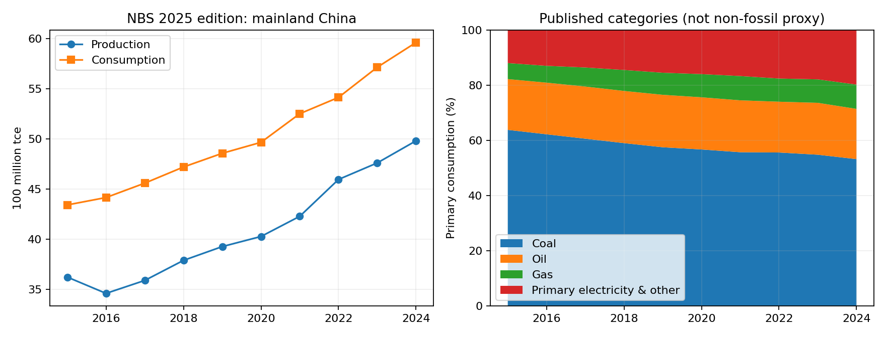
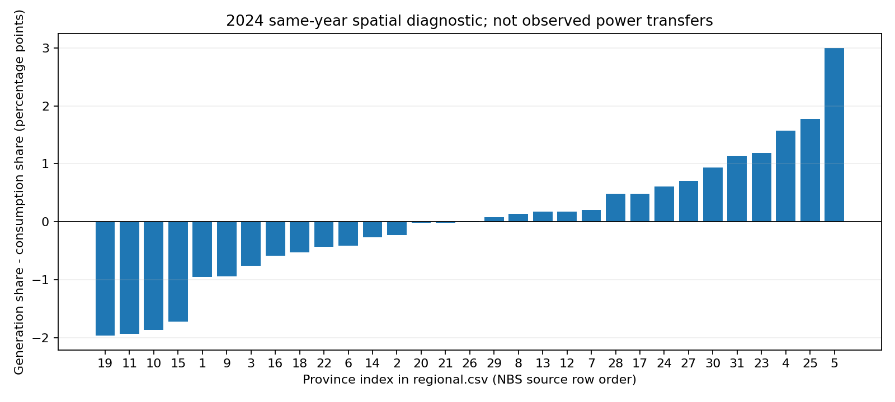

# Q1 当前多能源发展现状：mmj 候选研究交付

四项研究均有离线可复现候选产物；关键科学缺口仍在，Q1完整科学验收部分完成，PR保持Draft。
实际观测、条件成本实验和阻断项分别标记。全国真实初态、历史校准、预测仍未完成。

## 1. 历史规模、结构、区域与贸易/价格

2015—2024 使用统计局2025版同表去重序列；2024是候选现状，2023细账与2025更新分开。history.csv 保留原值、原单位、源页表/单元格、版本与缺失原因；同源重复转录不增加独立观测。

|指标|2015|2024|变化|
|---|---:|---:|---:|
|一次能源生产（万吨标准煤）|362193|498000|37.50%|
|能源消费（万吨标准煤）|434113|596000|37.29%|
|年末总装机（万千瓦）|152527|334922|119.58%|
|风电装机（万千瓦）|13075|52078|298.30%|
|太阳能装机（万千瓦）|4218|88742|2003.89%|

煤炭消费比重从63.8%降至53.2%，但其绝对规模未据此判定下降。2024油18.2%、气8.8%、一次电力及其他19.8%保留原分类。含气清洁能源28.6%不是非化石。NDC2025发布版另直接公布2024非化石一次消费占比初步测算19.8%（原PDF物理p5/印刷p3），与NBS分类分别保留；数值相同不等于同一观测或定义。NDC国家地域保留China，进入大陆模型前仍需桥接；其他年份未据此回填。
原煤47.81亿吨、气2464.51亿立方米、总发电100868.81亿千瓦时（10086.881 TWh）。九类能源细分十年发电与区域技术面板未齐全，缺口逐项列示，不填缺年。

2024进口公报分别保留煤及褐煤54270万吨、原油55342万吨、成品油4823万吨、气13169万吨及金额。这些质量不能无依据转换为国内气体体积或加总为一次能量。2015/2020/2022/2023同表煤油进出口与消费另列。

## 2. 四维评价

|维度|定量结果|解释|
|---|---|---|
|保障|2023煤净进口依赖9.99%；石油78.85%|同表同单位；不是2024或原油依赖|
|低碳|2024非化石一次消费初步值19.8%；煤份额53.2%；水核风太阳能发电占比36.81%|NDC初步值独立保留；发电子集含抽蓄未拆分，不代替一次非化石份额|
|经济|统一25年、5%实际WACC的陆风0.03104、海风0.05148（2024 USD/kWh）|共同融资条件实验，非官方LCOE重现、非到户或保供服务成本|
|协调|2024年31省发用电份额距离0.12656；风/PV利用率95.9%/96.8%|空间错配提示协调需求，不能直接断言不安全或推弃电量|

保障方面，同EI标准的分通道管道气、LNG与EJ煤分别计算来源组HHI；未解析来源组给逐国HHI界，国内报告气进口前五来源合计占81.29%。不构造五国点份额，不把总进口/表观消费叫净依赖。

|2024来源表|报告来源组HHI|逐国HHI下确界|逐国HHI上界|
|---|---:|---:|---:|
|pipeline|0.362433|0.362433|0.362433|
|lng|0.202003|0.201770|0.202003|
|coal_trade|0.224367|0.224260|0.224367|

低碳方面，逐年列出不变价GDP下能耗和GCB碳强度。WDI采用源系列基期，不冒称2020基价。CHN代码与大陆口径桥接仍为条件；GCB仅领土化石与工业，排除土地利用和移除，与公报扣除原料及非化石的官方能耗强度不可直接对比。没有为缺维重新配权的总评分。
研究口径下2024能耗强度为464.86 kgce/万元不变价CNY，2015=100指数为83.79；碳强度为0.9585 tCO2/万元，2015=100指数为76.08。这表示单位产出的变化，不等于总排放下降。

经济性采用 IRENA 同一原件的2024中国新建风电CAPEX均值、O&M假设及CF均值，统一25年、年末折现与恒定年输出，L=(CAPEX×CRF+O&M)/(8760×CF)，按3%、5%、7%实际WACC做敏感性。这些折现率是透明分析假设，不是中国实测融资率。报告公布陆风/光伏/海风LCOE=0.029/0.033/0.056另列，技术WACC不同，不解释为固定融资净效应，不再叠加CAPEX/O&M。成本仅未保供厂门kWh，不评价等可靠性全系统服务。
原报告说明项目CF通常为事前估计；国家CAPEX和CF均值未逐项目配对。本式是平均参数条件试算，不等于项目LCOE的加权平均，也不是全国在运机组实测成本。

|技术|3%|5%|7%|单位|
|---|---:|---:|---:|---|
|onshore_wind|0.02704|0.03104|0.03544|2024 USD/kWh|
|offshore_wind|0.04513|0.05148|0.05845|2024 USD/kWh|

价格波动固定考察2015—2024，仅使用可核验旧版2015—2020年度价格。Description!B12注明欧洲气价自2015年4月改为TTF，2015年度混合此前边境进口/现货组合与TTF。保留2015原值，但排除2016/2015变化；欧洲仅以2016—2020五个同定义水平、四个相邻变化计算样本标准差。其余五系列各有六水平、五个相邻变化；澳煤Description!B4自2015年1月为Newcastle 6000 kcal/kg现货，该归档版的采用年度均在同一定义内。2021—2024隔离缺失，不跨缺年、不拼接新版、不当国内到厂价。

|国际基准|对数变化样本标准差|有效相邻变化数|同定义水平年份|排除的已知相邻对|
|---|---:|---:|---|---|
|Coal, Australian|0.27231|5|2015、2016、2017、2018、2019、2020|无|
|Crude oil, Brent|0.28268|5|2015、2016、2017、2018、2019、2020|无|
|Crude oil, average|0.27412|5|2015、2016、2017、2018、2019、2020|无|
|Liquefied natural gas, Japan|0.25885|5|2015、2016、2017、2018、2019、2020|无|
|Natural gas, Europe|0.40160|4|2016、2017、2018、2019、2020|2015-2016: mixed_definition_level|
|Natural gas, US|0.17590|5|2015、2016、2017、2018、2019、2020|无|

协调性用两端各自31省合计作为份额分母，完整省集、同年和单位必须一致。
省级发电合计100868.83亿千瓦时，与全国产品表差0.02；用电合计98540亿千瓦时。未选到同版全国用电比较值，明确保留缺失。正份额差表示发电空间份额较大，不代表实测外送量。
2024抽蓄58.69GW仅功率。既有储能报告新增提取2024年底新型储能73.76GW；正文能量168GWh、图1能量168.2GWh分别保留，属于同源精度差，不平均、不计作独立证据。图1名牌E/P约2.280h；公布平均时长2.3h。新提取仍待两人确认，SOC/效率/分区运行状态未补齐。2025新型储能136GW/351GWh及约2.58h单独展示，不能回填2024或替代SOC。
同表地区分布：山西/内蒙古原煤产量合计占全国53.94%；四川/新疆/陕西/内蒙古天然气产量合计占70.95%；四川/云南水电发电合计占51.55%。这些是生产/发电空间份额，不是地下资源储量份额；其余省份的源表空白仍缺失。

|省份|发电份额−用电份额（百分点）|
|---|---:|
|广东|-1.965|
|浙江|-1.940|
|江苏|-1.864|
|山东|-1.728|
|北京|-0.958|
|内蒙古|3.002|
|云南|1.773|
|山西|1.574|
|四川|1.184|
|新疆|1.135|

## 3. 能源角色、优势、短板与接口

|能源/配套|角色与优势|短板|协同及Q2位置|
|---|---|---|---|
|煤|大规模供能与电热调节；国内规模大、可库存|碳排放、洗选口径和灵活性成本|与风光互补；热电耦合；CCUS需额外能耗；煤矿/热电主体；燃料库存、排放与运行约束|
|油|交通燃料和石化原料；液体燃料储运方便|净进口暴露大；燃烧与原料不能混算|终端电气化、替代燃料和炼化用氢；进口、炼化、交通与原料流分记|
|气|工业/城市燃料与调峰发电；调节和终端用途广|进口来源集中、季节库存/甲烷和燃料成本未知|储气、管网、气电和需求响应；气源-储气-气电链，季节与通道约束|
|水电|可再生发电与调节；库容水电可提供调节|来水季节性、生态约束和跨区依赖|与风光储及跨区输送协同；常规水电与抽蓄分开；水量和库容约束|
|核电|稳定低直接排放电量；全年稳定供电潜力|工程周期、资本和安全/运行约束资料不足|与可变电源协调检修和负荷调节；机组投建/检修/出力边界候选|
|风电|可变可再生电源；规模增长；同价年陆风成本参考低|出力时序/网络和消纳约束|跨区、储能、负荷响应与气煤调峰；分区资源出力、建退役及成本主体|
|光伏|可变日间电源；快速扩张；模块化部署|昼夜错配、网络和储能需求|储能、需求侧移峰、可再生电解制氢；区分太阳能总项与PV；DC/AC边界明确|
|生物质|燃料型发电/热与资源利用；可调燃料路径候选|可持续原料、运输、生命周期排放与规模约束|热电联产；BECCS需可持续性及永久封存证明；原料供给、转换与过程碳|
|氢能|二次载体和化工原料；可衔接难电气化需求与可再生电力|当前化石制氢主导；效率/储运成本缺失|电解-储氢-工业；化石制氢与CCUS分别计碳；生产投入/产氢/库存/终端用途与损失|
|储能|跨时段搬运电能/气氢库存；功率与能量分开可描述调节|初始SOC、效率、时长与可用率不足|与风光、调峰、需求响应共同约束；P/E/SOC/充放电效率连续状态|
|输送|跨区电/气资源配置；缓解资源与负荷空间分离|候选线路未核验；容量/潮流和损耗缺失|风光水电外送、管道气与多区域平衡；分区有向网络、流量上限与损耗|
|CCUS|排放捕集、利用与封存链；难减排路径候选|捕集率、能耗、运输与永久封存数据不足|工业、化石电厂及条件BECCS；排放生成/捕集/利用/永久封存分别记账|

角色判断是研究解释，不当成新的统计观测。energy_roles.csv逐条列证据和边界；煤/气调峰、核电稳定性、水库调节是待模型约束验证的作用，不宣称已由年度统计证明可靠性。

## 4. 静态核对、Q2交接与未闭合原因

|2023账|单位|供给重建残差（公布供给−计算）|使用重建残差|供给−消费|公布平衡差额|
|---|---|---:|---:|---:|---:|
|NBS_2025_C09-03|10^4 tce|0.0|0.0|15520.0|15519.0|
|NBS_2025_C09-04|10^4 t|-1.0|0.0|1890.0|1890.0|
|NBS_2025_C09-05|10^4 t|-1.0|0.0|19890.0|19890.0|
|NBS_2025_C09-06|10^8 kWh|1.0|0.0|1.0|None|

总能源消费=终端+加工转换损失−回收能+损失；石油=终端+转换投入+损失；煤=终端+转换投入；发电/供热属于转换投入的嵌套行，不再次相加。电力=终端+输配损失。2023总能源供给−消费15520与公布15519相差1，保留。石油、煤供给重建各有−1舍入残差。氢约分类合计3632万吨，总量原文为超3650万吨，18仅是相对门槛的差，不能当精确残差。

GCB逐年分项和与Total的残差逐一保留。此恒等式只检验同清单算术，不是独立燃烧活动核算。2024物理能源—碳闭合明确阻断：燃烧/原料分流、热值、氧化率、过程排放、捕集、封存与移除不齐全。电力、氢不再作为一次能量重复加总，捕集不等永久封存。

model_handoff.csv给出2024年末规模/容量初态候选、2015—2024校准目标候选与阻断约束。GDP单列为外生驱动候选，不进入能源模型拟合目标；每项观测候选保留地域、来源、边界和源状态。2015—2021用于训练；2022—2024是已接触留出，不重新包装为盲测。所有候选仍需Q2输入审查，未修改原九子集用途契约。

## 缺口与验收

完整列表见 gaps_and_conflicts.csv；重点为价格版本、一次非化石定义、气平衡、同可靠性跨能源成本、时序网络/弃电、2024储能状态、物理碳账、技术长面板和跨源地域/GDP桥接。这些限制不以零值填补，也不通过一致性检查自动准入。

A1—A4：四项候选已交付，但覆盖与关键维度仍有缺口，只能标为部分完成，不能据文档齐全通过Q1完整验收。A5—A6：以本次run_manifest和validation证据中的实际执行为准。A7：待另外两人核对同一最终SHA并批准；当前没有正式验收通过或合并结论。

复现：`python -B -X utf8 run.py q1 --output-dir outputs/q1/review_mmj`。入口仅使用已登记本地文件；缺失、指纹不符、单位/边界错误返回非零。输入与输出哈希、命令、依赖、Git提交和工作树状态见run_manifest.json。
