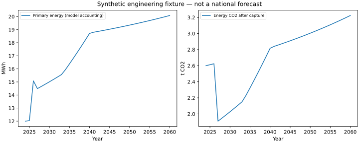
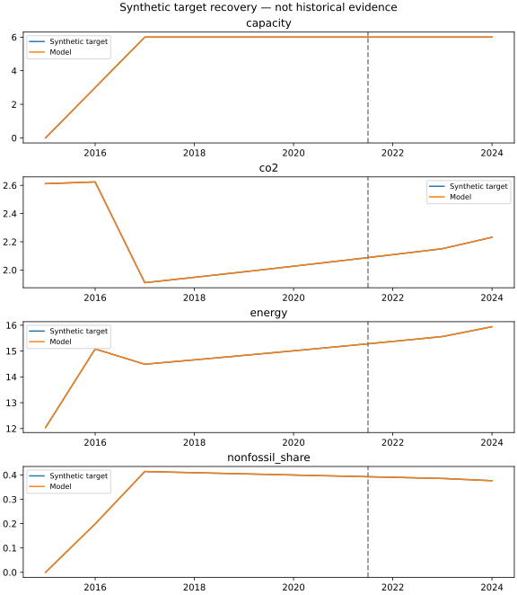

# Q2 工程复现记录

本次运行仅使用合成工程夹具；不构成全国历史校准、S0 预测或问题二验收通过。

实际运行 3 组训练参数、固定参数的已接触留出评估，以及三因素组合实验。训练指标四类齐备只验证计算接口，数值来自合成模型，不是观测中国。

年度主体申请经资金、接入和许可审核后入未来队列；运行采用服务优先的分层求解。含储能互斥时为 MILP，其余为 LP。资源费、碳履约转移和建设承诺分别记账。

全国输入缺口以 workflow/q2_inputs.json 为准；该正式入口当前应拒绝产生全国结论。
