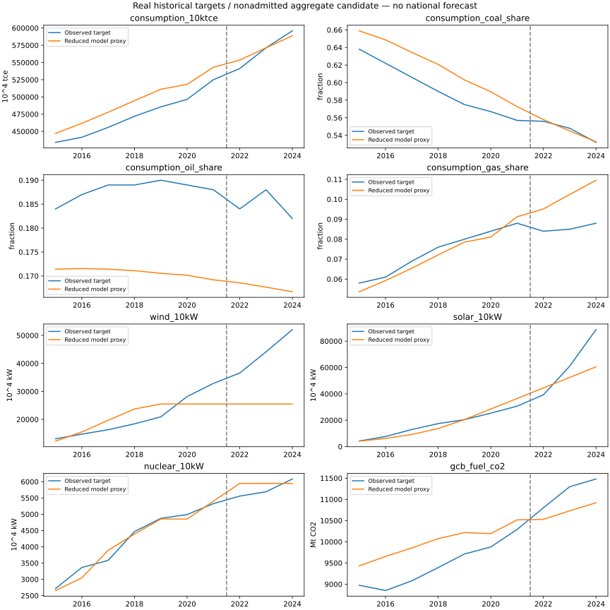

# 全国历史聚合候选 v10：实测目标诊断，未准入

此结果使用真实 NBS/GCB 历史观测和明确研究假设。它不是合成目标恢复，也不是全国问题二验收通过。初态、统计桥接、残余消费服务、年龄/队列和历史政策仍有实质缺口，详见冻结的 assumptions.json。

实际执行 1458 次训练候选，1458 次成功。三个规则均先按2015—2021训练误差比较；结构对照为 `shared_construction_connection_pvqueue_2`。设计本轮时已看过前序版本留出，属于探索性修正，不是新的盲测。选中 `instant_margin` / `{'wind_stock_expansion_rate': 0.2681992337164751, 'solar_stock_expansion_rate': 0.49296057924376513}`，训练损失 0.161514。随后固定规则与参数，运行2022—2024已接触留出；没有按留出改变阈值或再次选参。

| 指标 | 留出MAPE | RMSE/持平基线 | 数值门槛 |
|---|---:|---:|---|
| consumption_10ktce | 1.16% | 0.165 | 通过 |
| consumption_coal_share | 0.33% | 0.135 | 通过 |
| consumption_oil_share | 9.20% | 4.126 | 未通过 |
| consumption_gas_share | 19.45% | 5.982 | 未通过 |
| wind_10kW | 41.13% | 1.518 | 未通过 |
| solar_10kW | 19.71% | 0.453 | 未通过 |
| nuclear_10kW | 4.58% | 0.558 | 通过 |
| gcb_fuel_co2 | 4.14% | 0.514 | 通过 |

未通过项：consumption_oil_share, consumption_gas_share, wind_10kW, solar_10kW。

容量、总量与能源结构分别计算，不能用总量误差掩盖技术路径错误。参考价格、现存设备年龄和初始队列的简化属于待检验假设；训练/留出失败并不证明某项实际政策失效。本候选不输出2030/2060预测、不计算全国中和率；正式入口的六组准入缺口继续有效。

