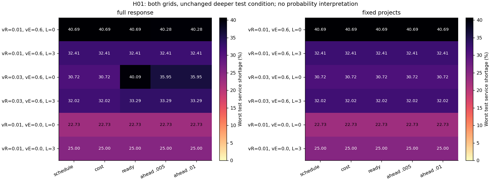
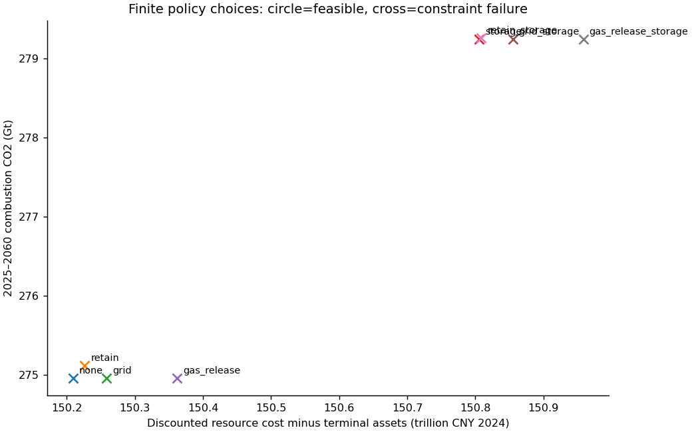
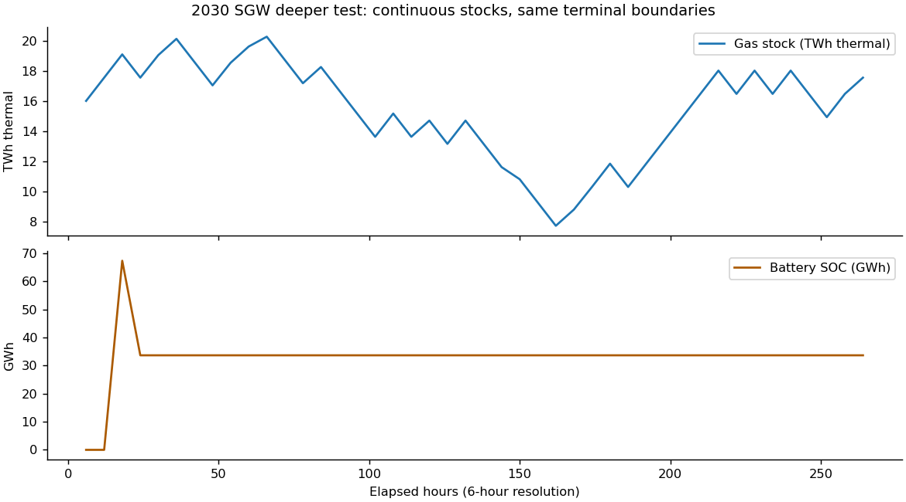

# 问题三：转型配套与受约束政策结果

已执行 116 个年度模型案例：H01 为 60 个，政策单项及组合 8 个，单因素政策比较 48 个。工程自查和 C9 团队批准独立记录，不能由运行成功替代。

## 同口径与信息边界

从共同2024初态运行到2060。H01的 vR 只调整初始煤电资产在寿命前5年内的提前退出授权，vE 是满足成本条件的到期更新/扩建设备采用份额，L 只增加网、储及注采设施工期。保留资产支付费用，最迟在原技术寿命或2060退出。单节点模型不输出地区拥塞或全年可靠性概率。

固定项目实验只回放固定日程对照已批准的申请，并在原决策年公开；资金不够即标失败。完整主体实验允许投资不同，不能把总效果都归于时序。费用排序可能因聚合煤电同质而与固定日程相同，不捏造逐厂成本差异。

预测使用当前资产、已承诺队列及预先冻结的压力平台条件；未承诺的未来项目不预支。实际安全评价使用连续事件。选择记录在执行较深检验前锁定；较深条件此前已接触，仍不是盲测。

## H01

共同选择约束下可行 0/60；检验集服务界内 0/60。后者只表示服务一项通过，不等于成本/排放/工程共同可行。逐点成本、排放、末期资产与各规则差分见 h01_results.csv、h01_comparisons.csv、h01_feasibility.csv。

## 政策筛选

主约束：相对同一转型参数下的无额外政策对照，累计燃烧CO₂不增加、折现毛资源成本不高于1.05倍、每个服务的缺供比例不超过1%，额外公共拨款每年不超过GDP的0.0005。预算是相同上限，不强制各方案花完同额资金。结果：**no_feasible_candidate**；选定策略：**None**。无可行解时不以替代边界冒充通过。

有限政策集合不等于全局优化。净费用扣除期末残值，同时公开毛成本、保留费用、维护费、资本承诺和实际付款；金融转移不重复算资源成本。policy_tradeoffs.csv 的其他界值只用于取舍敏感性。

无额外政策对照共有 10 条代表时段服务缺供记录；其中设备能力、服务主体付款预算、电网交付能力分别同时达到边界的记录数为 0、0、1。这些是同时约束的诊断标记，不是互斥归因；不能把设备/资金限制直接称为气源不足。逐条见 policy_bottleneck_flags.csv。

| 五方面 | 已执行的动作 | 相对对照净成本变化（万亿元） | 检验最坏缺供比例变化（百分点） | 主约束 |
|---|---|---:|---:|---|
| 能源结构 | retain | 0.0171 | 0.0000 | carbon;service |
| 多能调度 | grid_storage | 0.6457 | -9.6006 | carbon;service |
| 储备应急 | gas_release | 0.1528 | 0.0000 | service |
| 市场机制 | retain | 0.0171 | 0.0000 | carbon;service |
| 科技应用 | storage | 0.5964 | -9.6006 | carbon;service |

每项建议的执行者、付款者、投入、首年投运、证据与失效限制见 policy_recommendations.csv。气体注采能力只提高已有库存的出入速率，不增加库容、进口来源或初始储量；其费用是假设，已做半倍/双倍敏感性。储能部署使用继承的技术水平，ST外部降本不是可免费选择的政府动作。氢、CCUS、居民和就业缺乏本轮准入输入，不虚构其效果。

## 稳健性和失败

六个单因素变体各自重跑八项政策，保留/维护约束、供给、初态和需求不随排名改变。选择后评价检验集，排序记录见 sensitivity_rankings.csv；全部原始点见 sensitivity.csv。无效政策、无可行解、固定项目融资失败与求解失败分别保留，不能把失败填成零损失。

代码与配置是条件研究实现。Q2的聚合重建、价格/融资/初始队列假设、已接触历史评估、缺同口径CO₂留出及气油生物质残差继续有效；本轮不重标为已解决。完整审查证据在 outputs/validation/p3_mmj，团队批准需另外两人对同一最终SHA给出。
